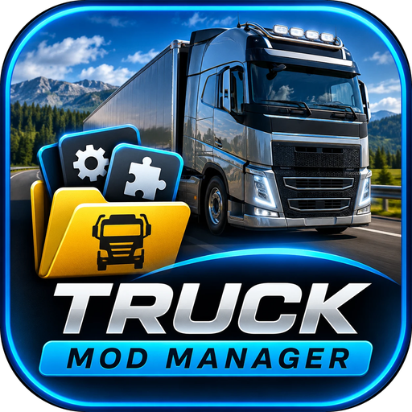
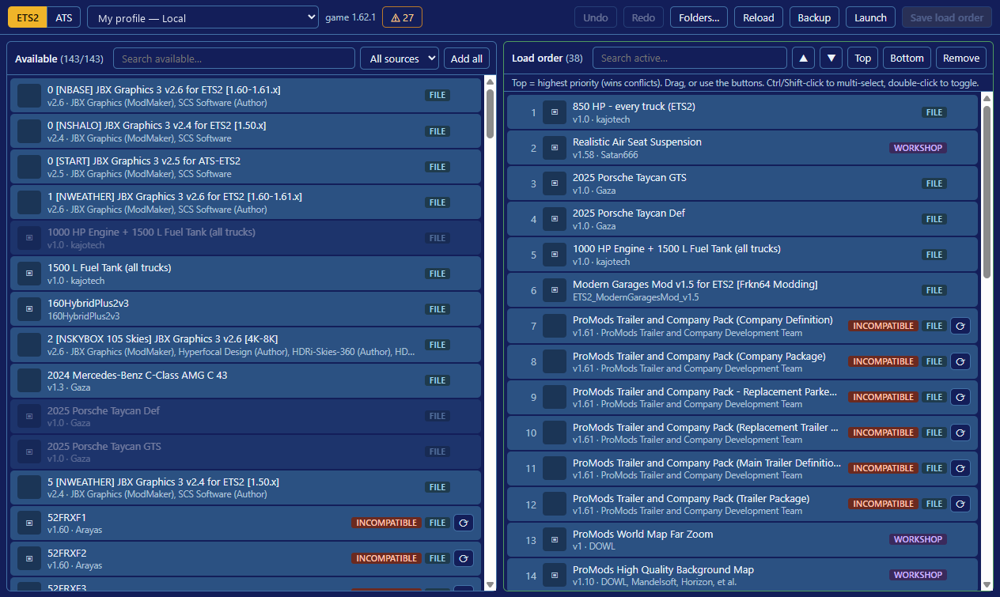

# Truck Mod Manager

A compact mod manager for **Euro Truck Simulator 2** and **American Truck Simulator** on Windows. It shows every mod you have installed next to your profile's load order, so you can sort, enable and disable mods faster than in the game's own Mod Manager.



## Features

* **ETS2 and ATS**, with every profile (local and Steam Cloud) in a drop-down.
* **Two lists**: *Available* (all installed mods, from the mod folder and the Steam Workshop) and *Load order* (the profile's active mods, top = highest priority).
* **Sort the load order** by dragging, with ▲ ▼ / Top / Bottom, multi-select (Ctrl/Shift-click) and double-click to add or remove. **Undo / Redo** (Ctrl+Z / Ctrl+Y).
* **Version check**: mods made for an older game version are marked *Incompatible*; the ⚠ button counts the active ones and filters the list to them. The ⟳ button looks for an update (Workshop page, Workshop search or a web search).
* **Names for every mod**: from the mod's manifest, from what your other profiles saved, or from the Steam Workshop title.
* **Extra mod folders** (*Folders…*) for mods kept outside the game's own mod folder.
* **Safe saving**: *Save load order* writes the profile's active-mod list only and makes a backup of `profile.sii` first. *Backup* saves a copy wherever you choose.
* **Launch** starts the game through Steam.

## Install

Download **TruckModManagerSetup-<version>.exe** from the [latest release](../../releases/latest) and run it, or use the portable zip (unzip anywhere and run `Truck Mod Manager.exe`).

The installer isn't code-signed, so Windows SmartScreen may say *Windows protected your PC*: click **More info**, then **Run anyway**.

## Use

1. Close the game (it rewrites the profile when it exits).
2. Choose **ETS2** or **ATS** and your profile.
3. Add, remove and reorder mods, then click **Save load order**.
4. Start the game; the Mod Manager in the game shows the new order.

If a profile is saved in the game's binary format, the app says so: set `g_save_format "2"` in the game's `config.cfg`, load the profile in the game once, then try again.

Steam Cloud profiles: the game may download the cloud copy over your change. If that happens, turn off Steam Cloud for the profile in the game, or save the load order again after the game has synced.

## Build from source

Needs Node.js 20 or later.

```
npm install
npm start            # run
npm run installer    # dist\ (portable) and release\ (installer)
```

## Licence

MIT. Not affiliated with SCS Software. Inspired by the GMC Mod Manager; no code from it is used.
